# agent-ready-analytics

[](https://github.com/JacobWillson13/agent-ready-analytics/actions/workflows/ci.yml)


[](LICENSE)

Data agents can write SQL. They can't infer your business rules. This project measures how much a
governed context layer (dbt docs, a MetricFlow semantic layer, business guides) changes a data agent's
accuracy, cost, and latency, and whether it lets a small model running on one consumer GPU compete with an
API model. It runs on BigQuery, dbt, MetricFlow, LangGraph, and LangSmith, with every answer scored in code
against an answer key computed from simulation state.

> **All company data is synthetic.** Lanternfly Labs is a fictional developer-tools SaaS company generated
> by a seeded simulation in this repo. The PyPI download and GitHub release data is real.

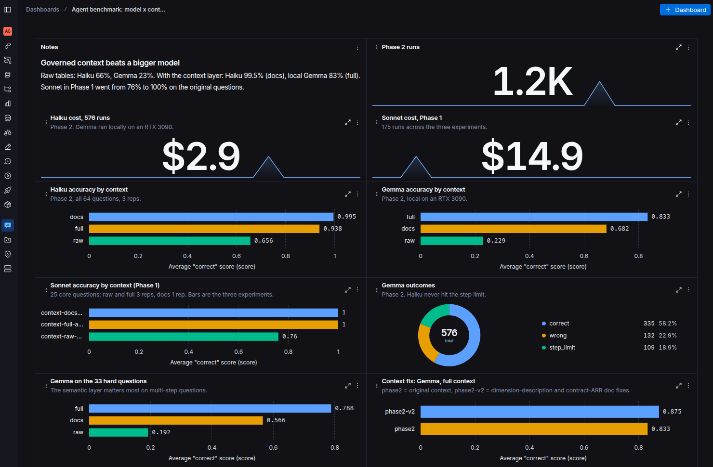

*The benchmark in LangSmith. With raw tables, local Gemma 4 26B gets 23% right; with the governed context layer,
83%. The dashboard is built from code in [`dashboards/langsmith/`](dashboards/langsmith/).*

## Results

64 questions, 3 context levels, 2 models, 3 runs each: 1,152 agent executions. Claude Haiku 5.5 runs
through the Anthropic API; Gemma 4 26B runs locally on an RTX 3090 through Ollama. Full methods, tables,
and failure analysis: **[docs/REPORT.md](docs/REPORT.md)**.


| Accuracy, all 64 questions | raw tables | dbt docs | full context |
|---|---|---|---|
| Claude Haiku 5.5 (API) | 66% | 99.5% | 94% |
| Gemma 4 26B (local) | 23% | 68% | 83% |
| Gap, Gemma minus Haiku | -43 pts | -31 pts | -10 pts |

95% intervals are question-clustered bootstrap intervals; see the report.

1. **Context matters more than the model.** Full context raised the local model by 60 points and cut the gap
   to the API model from 43 points to 10. Gemma does not reach parity: the gap's interval at full context is
   -18 to -3 points.
2. **The best context depends on the model.** Governed metrics and guides added 15 points for Gemma and cost
   Haiku 6. Haiku did best with dbt docs alone.
3. **The eval found real defects in the context layer.** Every Haiku full-context error traces to one of
   three causes: a semantic-layer dimension that reports current state, used for a point-in-time question;
   endorsement steering that hides the only model holding contract ARR; and one ambiguous question. Gemma
   failed the same questions. In a follow-up rerun, fixing the dimension descriptions took those questions
   from 2 of 12 runs correct to 11 of 12. Rewording docs and the prompt did not fix the contract questions
   (2 of 12 to 1 of 12); that needs a structural change. See the report's follow-up section.
4. **The local model's weakness is finishing, not reasoning.** Gemma hit the 60-step limit on 19% of runs.
   When it finished with full context, it was right 94% of the time.
5. **Context is cheaper.** With full context Haiku used 63% fewer input tokens and 59% less time than with raw
   tables. The full 576-run Haiku benchmark cost $2.84.


### Phase 1: one model, original questions

Phase 1 ran Claude Sonnet 5.5 on the 31 original questions (25 core, 6 held out) and found the same
direction: on the core set, 76% with raw tables and 100% with docs or full context, with full context using
about a quarter of the tokens. It also set up context changes to be evaluated like code. In
[PR #1](https://github.com/JacobWillson13/agent-ready-analytics/pull/1), traces showed the full-context agent
rediscovering metrics on every question; injecting a compact index cut tokens 43% and latency 32% with
accuracy held. [PR #3](https://github.com/JacobWillson13/agent-ready-analytics/pull/3) runs that eval on every
pull request that touches context and posts the change as a comment.

Phase 2 added a second model, 33 harder questions written before any Phase 2 run, repeated runs, and
statistical intervals, because Phase 1's 100% results could not separate the context levels.

## What it looks like

### Same question, with and without the context layer

"What was net new ARR in Q3 2026?" The answer is $6.59M. With raw source tables, Haiku made 20 tool calls and built a careful, well-documented estimate from
Salesforce bookings and Metronome invoices: $3.50M, about half the true value, because bookings and invoices
are not ARR. With full context, the agent read two values of the governed `arr` metric and subtracted them in
3 tool calls.

<table>
<tr>
<td width="50%">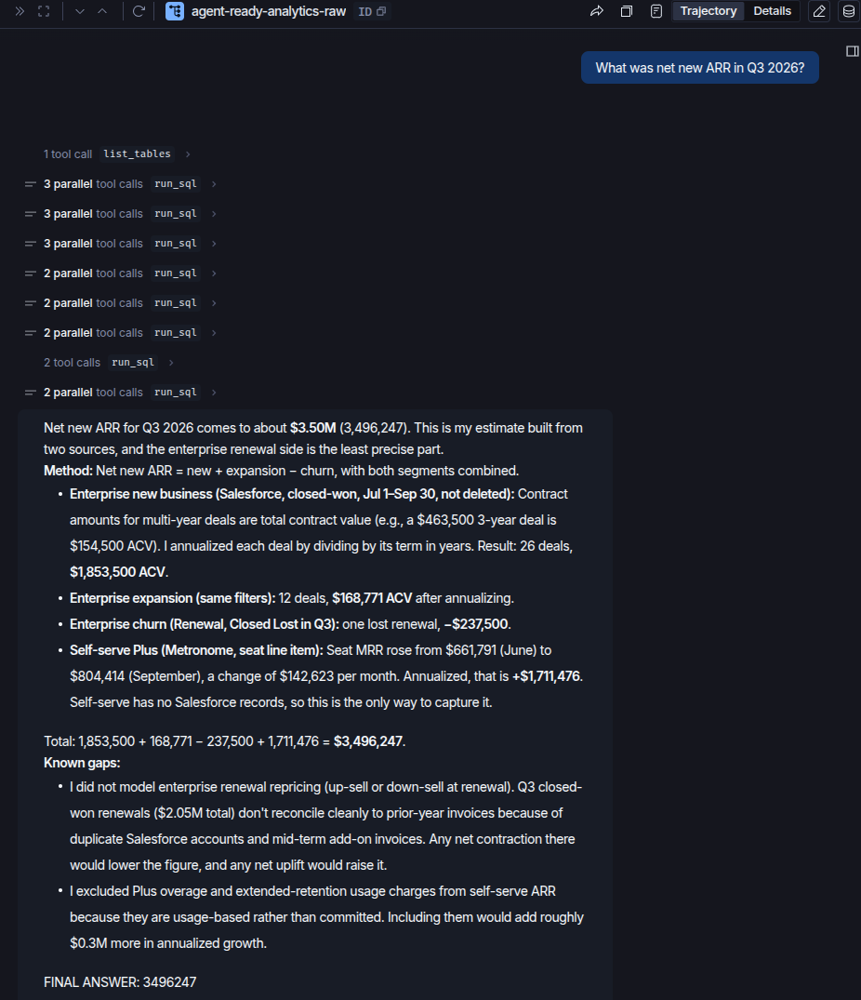</td>
<td width="50%">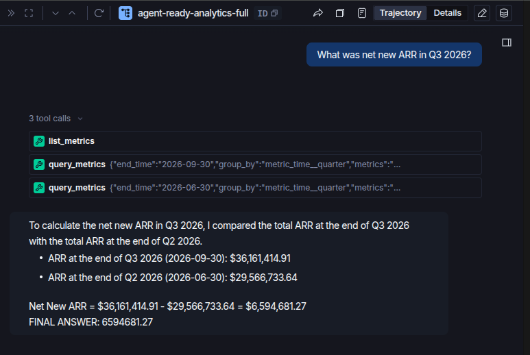</td>
</tr>
<tr>
<td>Raw tables: 20 tool calls, $3.50M (wrong)</td>
<td>Full context: 3 tool calls, $6.59M (correct)</td>
</tr>
</table>

### The defect, in a trace

Asked how many enterprise customers were paying at the end of September 2026, Haiku with full context
grouped the governed `paying_customers` metric by `customer__motion`, which is each customer's motion today,
not in September. It answered 252; the answer is 251. Gemma made the same choice with a filter instead of a
group-by, which is why the report treats it as a context defect rather than a model quirk. The follow-up fix
put each dimension's description in front of the agent.

<table>
<tr>
<td width="50%">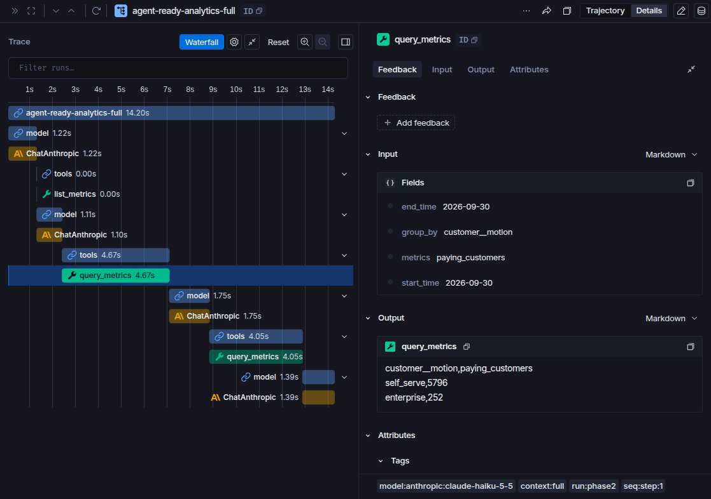</td>
<td width="50%">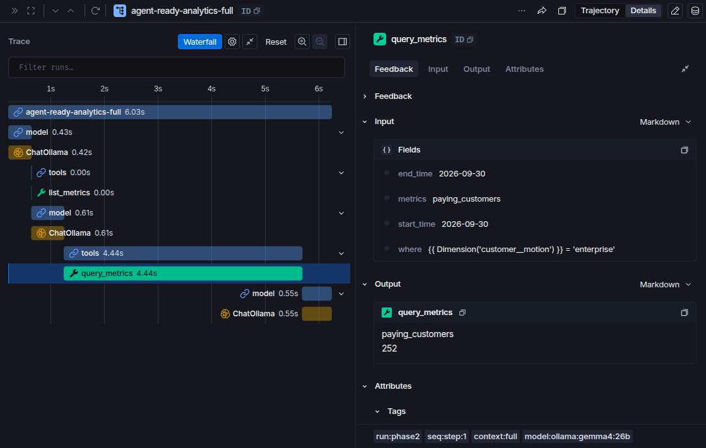</td>
</tr>
<tr>
<td>Haiku 5.5: groups by today's motion, 252</td>
<td>Gemma 4 26B: filters on today's motion, 252</td>
</tr>
</table>

After the fix, a Haiku full-context run answered 251. It read the new dimension description, saw that
`customer__motion` is today's value, and counted from the endorsed mart's month-level `motion` column with
SQL. It still missed the governed route: its claim that `paying_customers` has no as-of-month motion split is
wrong, since `customer_month__motion` is in the same semantic model. The fix stopped the wrong dimension; it
did not guarantee the metric path.

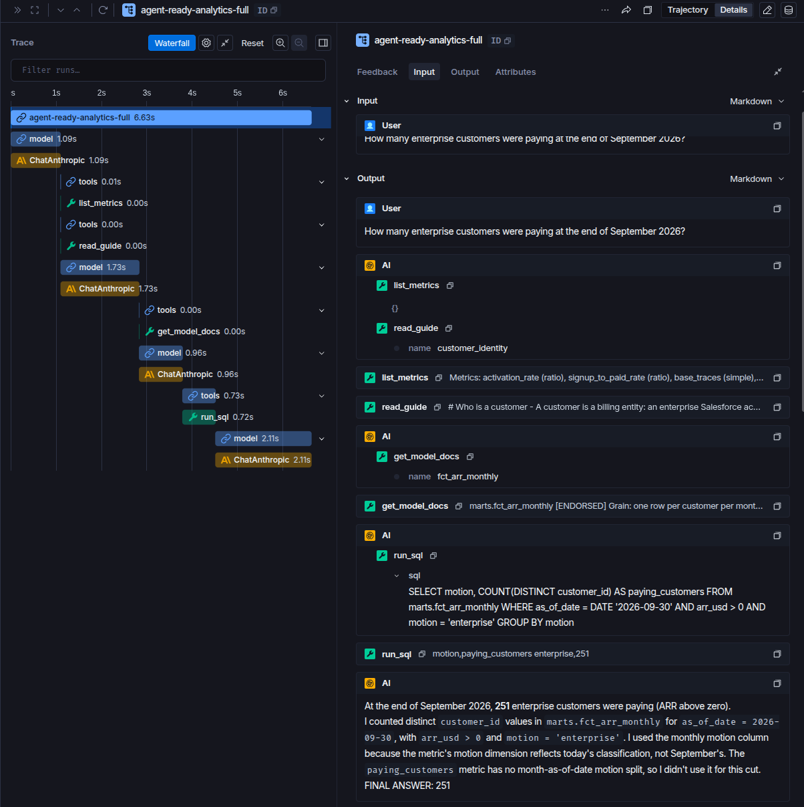

### More agent behavior

With dbt docs only, the agent reads that ARR is a balance and reports it at the end of the period instead of
summing months, one of the planted traps:

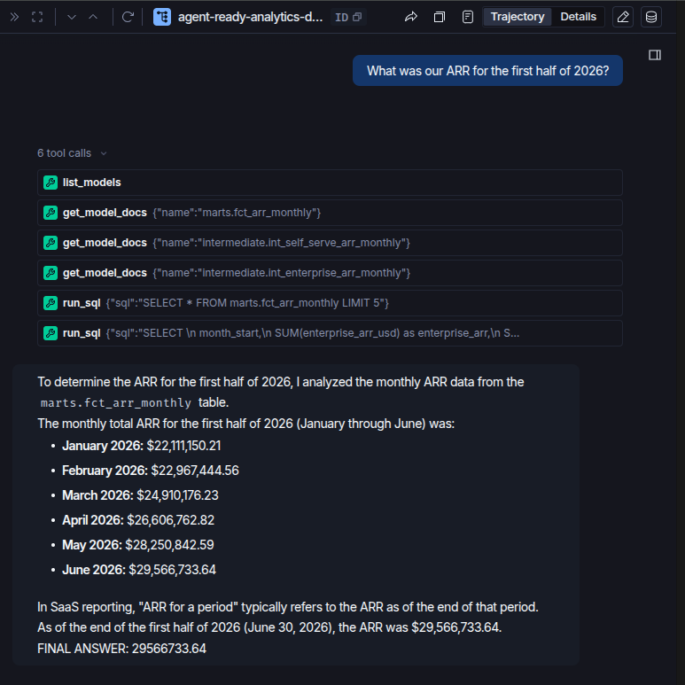

Gemma with raw tables only: a long chain of SQL guesses, including filtering on deployment type when the
question is about sales motion:

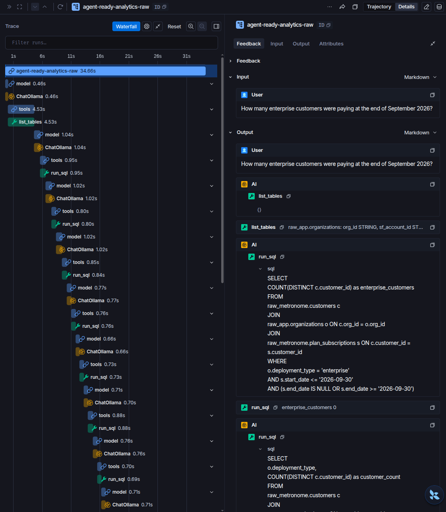

### Evaluation in LangSmith

The benchmark dashboard is defined as code in [`dashboards/langsmith/`](dashboards/langsmith/). One script
attaches each locally scored result to its trace as feedback and verifies every run carries it; another builds
the charts through the LangSmith API.

The accuracy half is at the top of this README. The efficiency half:

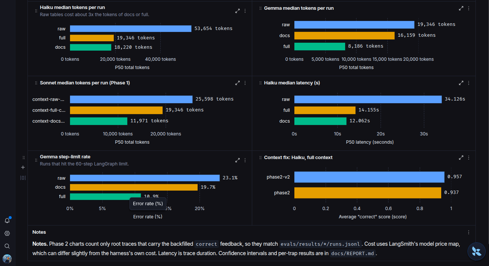

Every benchmark execution is traced and tagged by run, model, and context level:

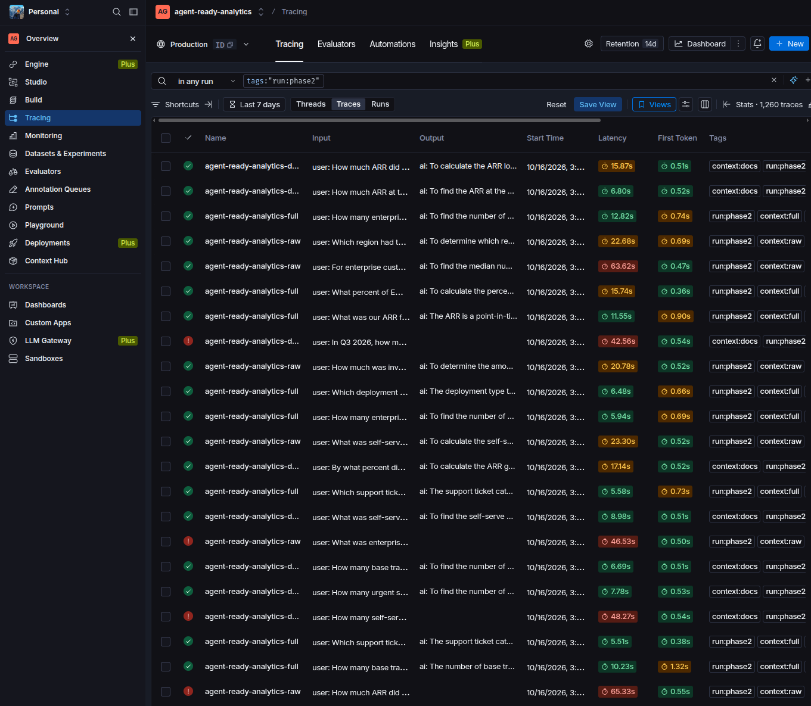

Phase 1 experiments on the 25 core questions (raw 0.76, docs and full 1.00):

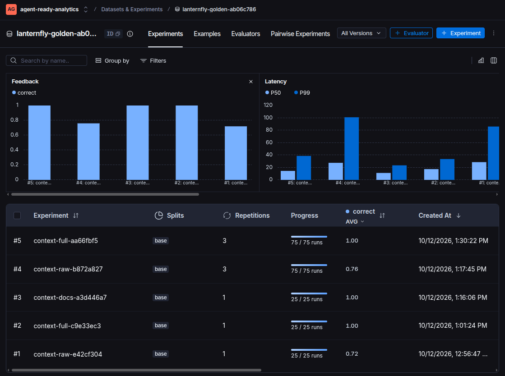

### The warehouse in BigQuery

Raw, staging, intermediate, and mart datasets, with dbt column descriptions persisted to BigQuery:

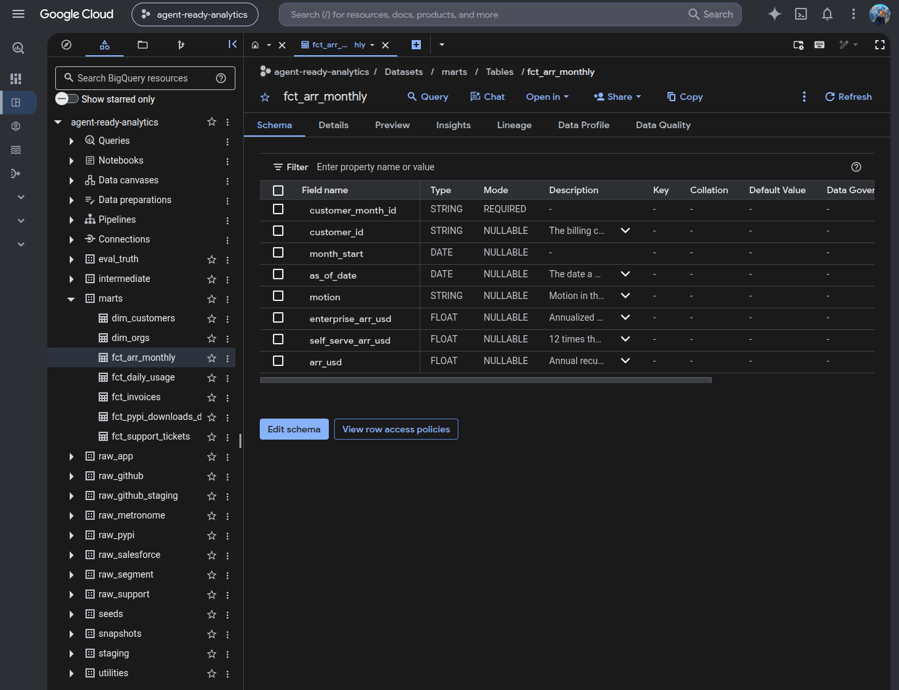

ARR by motion from the endorsed mart. September 2026 totals $36.16M, matching the answer key:

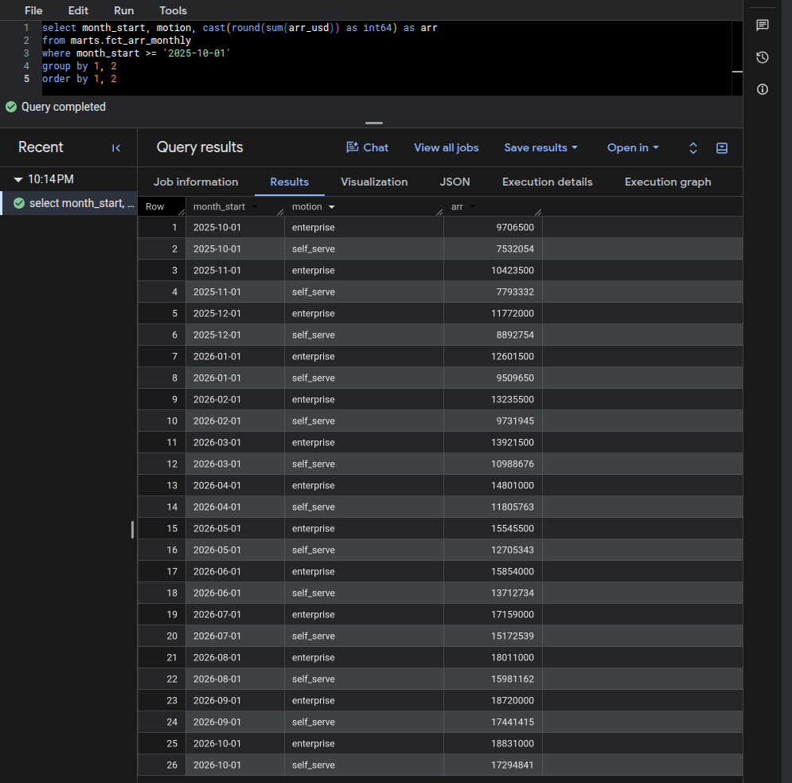

The answer key in `eval_truth` is readable by the CI service account but not the agent's:

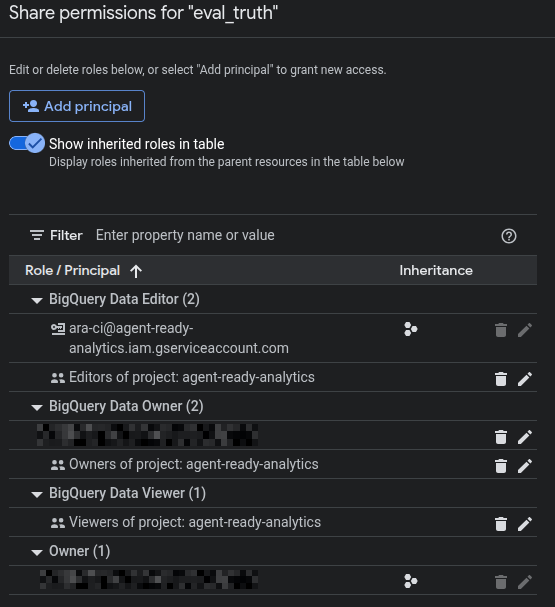

## The setup

Lanternfly Labs sells an LLM observability platform through a free plan, a self-serve Plus plan ($39 per seat
plus usage, billed monthly), and sales-led enterprise contracts with cloud, hybrid, and self-hosted
deployments. The simulation covers January 2024 to October 14, 2026: about 80,000 orgs, $36.2M ARR, and
6,048 paying customers.

It plants 13 data traps that real SaaS data teams deal with, each with a defense somewhere in the context
layer: total contract value booked as ARR, self-serve revenue missing from the CRM, enterprise prepay
invoices that double count ARR, churned accounts still marked Active, upgrades that look like churn,
self-hosted deployments with no telemetry, internal usage, duplicate events, and others. See
[docs/DATA_GENERATION_PLAN.md](docs/DATA_GENERATION_PLAN.md).


## Context levels

| Level | Agent can see |
|---|---|
| raw | Raw source tables only |
| docs | dbt models and their documentation (no endorsements, guides, or metrics) |
| full | Everything in docs, plus endorsement ranking, governed metrics through MetricFlow, business guides, and a compact index of metrics and guides in the prompt |

## Stack

| Layer | Tool |
|---|---|
| Synthetic sources | Seeded Python generator: Salesforce, product DB, Segment, Metronome, support desk |
| Real sources | PyPI downloads (BigQuery public dataset) and GitHub releases (dlt) |
| Warehouse | BigQuery |
| Modeling | dbt Core 1.12: contracts, unit tests, incremental Segment model, SCD2 snapshot, exposures |
| Metrics | MetricFlow, dbt 1.12 Semantic Layer spec |
| Business context | `guides/*.md`, versioned and code-owned |
| Agent | LangChain `create_agent` on LangGraph; CLI and MCP server |
| Models | Claude Haiku 5.5 and Sonnet 5.5 (API); Gemma 4 26B through Ollama on an RTX 3090 |
| Evals | LangSmith experiments; `evals/benchmark.py` and `evals/analyze.py` for the model by context benchmark |
| CI | GitHub Actions runs dbt build, reconciliation tests, and the context eval on pull requests |
| Dashboard | LangSmith custom dashboard, defined as code in `dashboards/langsmith/` |

## How it flows

1. `generator/` simulates 33 months and writes raw parquet plus an answer key.
2. `scripts/load_bq.sh` loads raw tables into `raw_*` datasets and the answer key into `eval_truth`.
3. `ingest/` pulls real PyPI and GitHub data.
4. dbt builds staging, intermediate, and endorsed marts, then runs tests, including reconciliation tests
   that compare marts to the answer key.
5. The agent answers questions with tools that read dbt docs, endorsements, guides, and metrics.
6. `evals/build_golden.py` computes golden answers from the answer key; `evals/benchmark.py` runs every model,
   level, question, and repetition; `evals/analyze.py` produces the tables and figures.
7. `dashboards/langsmith/` attaches each score to its LangSmith trace and builds the benchmark dashboard.

## Run it

```
uv sync
cp dbt/profiles.yml.example ~/.dbt/profiles.yml        # reads the project from $GCP_PROJECT
gcloud auth application-default login
source ~/.config/ara/env                               # your copy of .env.example, kept outside the repo

make generate            # ~3 min, ~320 MB parquet; use SCALE=0.05 for fast iteration
make load GCP_PROJECT=$GCP_PROJECT
make ingest GCP_PROJECT=$GCP_PROJECT   # scans ~300 GB of the public PyPI dataset; run the dry run first
make build               # dbt build + semantic validation
make golden              # answer key -> evals/golden.jsonl (rebuild after every generate)
make agent Q="What was total ARR at the end of September 2026?"

ollama pull gemma4:26b   # local model, about 18 GB
make bench-smoke         # 3 questions per model and level; checks keys, tools, and BigQuery
make bench-pilot         # Haiku, full context, hard questions (about $0.12)
make bench               # full benchmark; resumable, stops Haiku at $8
make analyze             # tables in evals/results/phase2/summary.md, figures in docs/figures
make dashboard           # scores -> LangSmith feedback, then build the LangSmith dashboard
```

The benchmark checks credentials, the GCP project, and the Ollama model before it runs anything.

## Credentials

Two service accounts, least privilege:

- `ara-ci` builds models and runs the reconciliation tests, so it can read and write every dataset,
  including the answer key in `eval_truth`.
- `ara-agent` runs the agent. It can read every dataset except `eval_truth`. The agent's SQL tool also
  enforces a dataset allowlist per context level, so the answer key is blocked twice.

CI holds no service account keys. GitHub Actions authenticates through Workload Identity Federation, limited
to this repository; setup is in [docs/WORKLOAD_IDENTITY.md](docs/WORKLOAD_IDENTITY.md).

## Background

The architecture follows patterns data teams have published about running agents on their warehouse,
including LangChain's write-up
[How we built LangChain's agent-first data stack](https://langchain.com/blog/agent-data-stack) and Hex's
[LangChain customer story](https://hex.tech/customers/langchain/): rich dbt definitions, a semantic layer,
written business guides, endorsement signals, and observability feeding a context improvement loop. This
project builds the evaluation that loop needs and measures it across models. Lanternfly Labs is fictional,
and none of its numbers are estimates of any real company.
