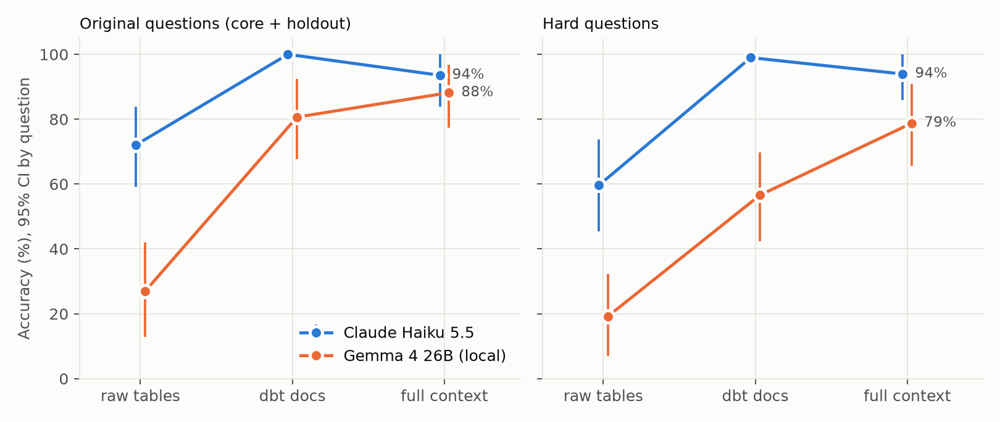
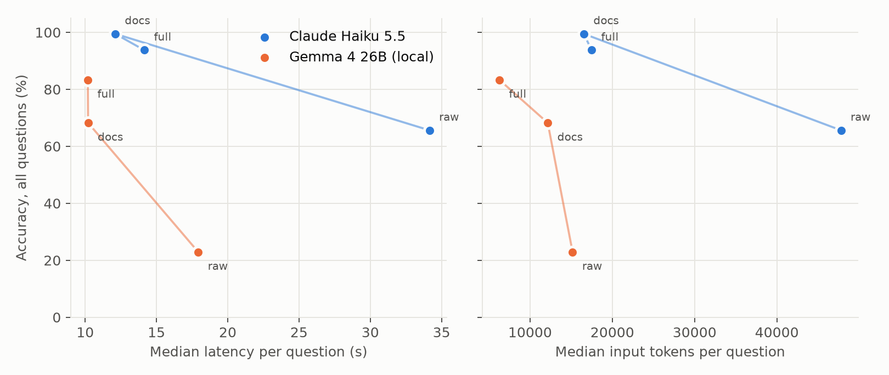
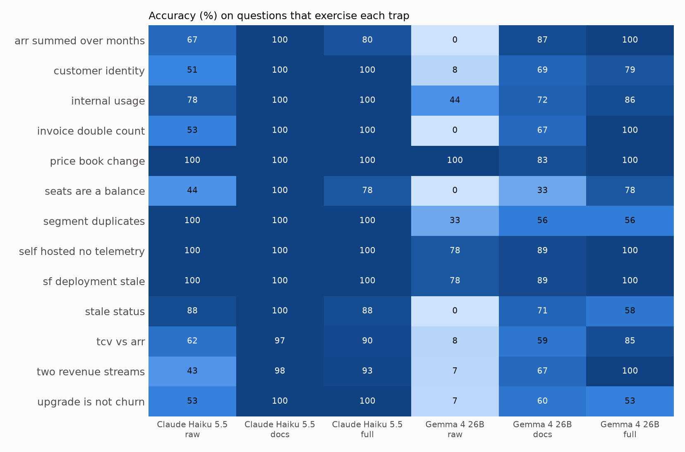

# Does governed context let a small local model match an API model on analytics questions?

Phase 2 benchmark report for agent-ready-analytics. Run date: October 16, 2026.

## Summary

A data agent answered 64 business questions about a synthetic SaaS company at three levels of context,
with two models: Claude Haiku 5.5 through the Anthropic API, and Gemma 4 26B (mixture of experts, 4B
active parameters) running locally on one RTX 3090. Each model ran every question 3 times at every level,
1,152 executions in total, scored in code against an answer key computed from simulation state.

1. **Context matters more than the model.** Moving Gemma from raw tables to the full context layer raised
   accuracy by 60 points (23% to 83%). The gap between the two models fell from 43 points on raw tables to
   10 points with full context.
2. **The two models need different context.** Gemma gained 15 points from governed metrics and business
   guides on top of dbt docs. Haiku lost 6 points from the same layer (99.5% with docs, 94% with full).
   That interaction is the main result: the best context layer depends on the model.
3. **The full layer has fixable defects, and the eval found them.** All of Haiku's full-context errors trace
   to three causes: a semantic-layer dimension that reports current state used for a point-in-time
   question, a prompt that steers the agent away from the only model holding contract ARR, and one
   ambiguous question. Gemma failed the same contract and customer-count questions for the same reasons.
4. **The local model's main weakness is finishing, not reasoning.** Gemma hit the 60-step limit on 19% of
   runs. When it finished with full context, it was right 94% of the time.
5. **Context makes the agent cheaper and faster.** Haiku used 63% fewer input tokens and 59% less time with
   full context than with raw tables. The complete Haiku run cost $2.84.

Gemma does not meet a 10-point non-inferiority margin against Haiku with full context (difference -10.4
points, 95% CI -18.2 to -2.6). On the original 31 questions alone the difference is -5.4 points (CI -17.2
to +5.4), which neither establishes nor rules out parity.

## Setup

### Data and questions

Lanternfly Labs is a fictional developer-tools SaaS company simulated from January 2024 to October 14,
2026: about 80,000 orgs, $36.2M ARR, and 6,048 paying customers across five source systems. The simulation
plants 13 data traps (total contract value booked as ARR, self-serve revenue missing from the CRM, churned
accounts still marked Active, and others), each with a defense somewhere in the context layer. See
[DATA_GENERATION_PLAN.md](DATA_GENERATION_PLAN.md).

| Split | Questions | Written | Purpose |
|---|---|---|---|
| core | 25 | Phase 1, with the context layer | Original benchmark |
| holdout | 6 | Phase 1, after the guides | Check for overfitting to wording |
| hard | 33 | Phase 2, before any Phase 2 model run | Multi-step questions; avoid the Phase 1 ceiling |

Hard questions combine at least two of: a trap, a time window, a cross-system join, or a derived metric
(retention, growth, share, median). Answers come from the generator's answer key, never from dbt. Before
the main run, a smoke test and a 33-question pilot checked the key against model behavior. That review
fixed one key: `x_sh_trace_share` had used per-day deployment while the models document current
deployment. The fix was made before the main run and was not tuned to any model's score.

### Context levels

| Level | The agent can see | Tools |
|---|---|---|
| raw | Raw source tables | `run_sql`, `list_tables` |
| docs | dbt models with descriptions, grain, and column docs | `run_sql`, `list_models`, `get_model_docs` |
| full | docs plus endorsement ranking, governed MetricFlow metrics, business guides, and a compact index of metrics and guides in the prompt | docs tools plus `list_metrics`, `query_metrics`, `list_guides`, `read_guide` |

The full level changes both information and tools, so the docs-to-full contrast measures the governed
layer as a bundle, not information alone.

### Models and settings

| | Claude Haiku 5.5 | Gemma 4 26B |
|---|---|---|
| Serving | Anthropic API | Ollama 0.34 on an RTX 3090 (24 GB), `gemma4:26b` tag (quantization and digest in the manifest) |
| Context window | API default | 32,768 tokens, set explicitly |
| Temperature | API default (newer Claude models reject other values) | 0, seed 42 |
| Thinking | Off | Off |
| Max output tokens | 4,096 | 8,192 |

Both models used the same LangChain `create_agent` loop, prompts, tools, BigQuery warehouse, and a
60-step LangGraph limit (about 30 tool calls). Each execution built a fresh agent. Order was shuffled with
a fixed seed. Runs that hit the step limit or timed out were scored wrong and kept in the denominator. If
an agent stopped without the required `FINAL ANSWER:` line, it got one uniform reminder; this happened in 3
of 1,152 runs, all Gemma.

### Analysis

Repeated runs of one question are correlated, so all intervals come from a bootstrap that resamples
questions (2,000 resamples) and keeps each question's runs together. Contrasts are paired by question. A
mixed-effects logistic model with a random intercept per question (`correct ~ model * level + (1 |
question)`) is reported as a check. Haiku's 99.5% docs accuracy is close to separation, which inflates the
log-odds estimates, so the bootstrap contrasts are the primary result. Code: `evals/analyze.py`.

## Results



### Accuracy (percent, 95% CI)

| Model | raw | docs | full |
|---|---|---|---|
| Claude Haiku 5.5, all 64 | 65.6 (56 to 75) | 99.5 (98 to 100) | 93.8 (88 to 98) |
| Gemma 4 26B, all 64 | 22.9 (14 to 33) | 68.2 (58 to 78) | 83.3 (75 to 92) |
| Claude Haiku 5.5, hard 33 | 59.6 (45 to 74) | 99.0 (97 to 100) | 93.9 (86 to 100) |
| Gemma 4 26B, hard 33 | 19.2 (7 to 32) | 56.6 (42 to 70) | 78.8 (66 to 91) |

### Paired contrasts (percentage points, all questions)

| Contrast | Haiku | Gemma |
|---|---|---|
| docs minus raw | +33.9 (+25.0 to +43.8) | +45.3 (+32.8 to +57.3) |
| full minus raw | +28.1 (+17.2 to +39.6) | +60.4 (+48.4 to +71.4) |
| full minus docs | -5.7 (-12.0 to -0.5) | +15.1 (+4.7 to +25.5) |

| Gemma minus Haiku | raw | docs | full |
|---|---|---|---|
| All questions | -42.7 (-52.6 to -32.8) | -31.2 (-41.2 to -22.4) | -10.4 (-18.2 to -2.6) |

The mixed-effects model agrees: positive context effects for both models, a negative model-by-docs
interaction, and a positive model-by-full interaction (+1.55 log-odds, interval +1.12 to +1.99).
Question-level variation is large (random-intercept SD 1.87 log-odds), which is why question-clustered
intervals matter here.

### Cost, latency, and tool use (medians per question)



| Model | Level | Tool calls | Input tokens | Latency | Cost | Step-limit hits |
|---|---|---|---|---|---|---|
| Haiku | raw | 11 | 47,793 | 34.2 s | $0.0090 | 0% |
| Haiku | docs | 9 | 16,536 | 12.1 s | $0.0030 | 0% |
| Haiku | full | 6 | 17,480 | 14.1 s | $0.0028 | 0% |
| Gemma | raw | 7 | 15,170 | 17.9 s | local | 23.4% |
| Gemma | docs | 8 | 12,151 | 10.2 s | local | 21.9% |
| Gemma | full | 3 | 6,270 | 10.2 s | local | 11.5% |

Cost is mean API spend per execution. Gemma's cost is local electricity and hardware, not reported as a
price. Token and tool-call medians cover finished runs only.

### By trap



On raw tables both models failed on rules that live only in the business: Gemma scored 0% on ARR summed
across months, enterprise invoices double counting ARR, seats as a daily balance, and churned accounts still
marked Active, and 7% or 8% on self-serve revenue missing from the CRM, total contract value booked as ARR,
upgrades counted as churn, and customer identity. Both models handled data-hygiene traps (self-hosted
telemetry gaps, stale CRM deployment fields) well even on raw tables, matching the Phase 1 finding that
context fixes business-rule errors more than hygiene errors.

## Why full context hurt Haiku

Haiku made 12 errors in 192 full-context runs, concentrated in 5 questions. Each traces to a specific,
fixable part of the context layer:

| Question | Runs wrong | Answer | Cause |
|---|---|---|---|
| `paying_ent_sep26` | 3 of 3 | 252, key 251 | The semantic layer exposes `customer__motion` (current motion, from `dim_customers`) next to `customer_month__motion` (motion in that month, from `fct_arr_monthly`). The agent filtered September paying customers on current motion. Recomputing with current motion from the answer key gives exactly 252. |
| `x_avg_plus_seats_q3` | 2 of 3 | about 17,700, key 18,442 | Same pattern: Plus seats filtered on the org's current plan instead of the plan on each day. Current plan gives about 17,670. |
| `x_contract_arr_2025` | 3 of 3 | 11.8M, 7.3M, "UNAVAILABLE" | Contract ARR lives only in `int_contracts`, an intermediate model that is not endorsed. The full prompt says to prefer governed metrics and endorsed marts. With docs, which has no endorsement ranking, Haiku found it 3 of 3 times. |
| `x_nb_arr_2026` | 1 of 3 | 6.96M, key 6.85M | Same cause as above. |
| `h_arr_change_ytd` | 3 of 3 | 75 | "How much did ARR grow" was read as a percent (75% is the correct percent growth). Question ambiguity, not a context defect. |

Gemma failed `paying_ent_sep26`, `x_contract_arr_2025`, and `x_nb_arr_2026` in all three full-context
runs, so these defects are systematic, not model quirks. The answer key for both contract questions was
confirmed independently: rebuilding contract ARR from raw Salesforce opportunities with the `int_contracts`
logic reproduces both keys to the dollar.

The practical lesson: a semantic layer that exposes both current-state and point-in-time versions of an
attribute needs the distinction stated where the agent picks dimensions, and endorsement ranking should
never hide the only source for a question. Both are one-line context changes, which is the loop the CI
eval exists to catch.

## Why Gemma underperformed

Gemma's errors split into two kinds:

| Level | Hit step limit | Finished but wrong | Accuracy when finished |
|---|---|---|---|
| raw | 23.4% | 53.6% | 29.9% |
| docs | 21.9% | 9.9% | 87.3% |
| full | 11.5% | 5.2% | 94.1% |

With context, most of Gemma's gap to Haiku comes from runs that never finish, not from wrong answers.
The full layer halves the step-limit rate because governed metrics answer many questions in one call
(median 3 tool calls against 8 with docs). Raising the step limit from 40 to 60 before the main run did
not rescue the runs that were looping: the first raw-context runs that hit 40 steps hit 60 as well. A higher
limit would mostly add latency.

Gemma's repetitions disagreed with each other on 25% of docs questions despite temperature 0 and a fixed
seed, so local inference was not deterministic in practice. Repetitions were kept and analyzed the same
way for both models.

## Limitations

- **Synthetic company, one author.** The same person wrote the simulation, traps, context layer, and
  questions. The hard split was written before any Phase 2 run and the holdout after the guides, which
  reduces but does not remove that bias.
- **Two models, one quantization.** Results describe Haiku 5.5 and one quantized build of Gemma 4 26B under these settings,
  not model families in general.
- **Bundled treatment.** The full level adds tools as well as information. A fixed-tool ablation would
  separate the two.
- **Answer-key conventions.** Two hard questions differ slightly between the answer key and dbt
  conventions: `x_ent_traces_q3` (0.3%, plan assignment on a few org-days) and `x_ss_avg_arr` (0.06%,
  counting in an upgrade month). Both are inside tolerance and did not change any score in the pilot.
- **Pricing.** Haiku cost uses list prices of $0.10 and $0.50 per million input and output tokens
  (`agent/providers.py`), applied to token counts reported by the API.
- **Determinism.** Neither model was deterministic across repetitions; intervals account for this by
  clustering on questions.

## Reproduce

```
make generate && make load GCP_PROJECT=$GCP_PROJECT && make build && make golden
make bench-smoke
uv run python evals/benchmark.py --run-id phase2 --models anthropic:claude-haiku-5-5 --repetitions 3 --cost-cap 8
uv run python evals/benchmark.py --run-id phase2 --models ollama:gemma4:26b --repetitions 3
make analyze
```

Raw results: `evals/results/phase2/runs.jsonl` (one row per execution) and `manifest.json` (model
digests, quantization, package versions, git commit, and settings). Full tables:
`evals/results/phase2/summary.md`.
